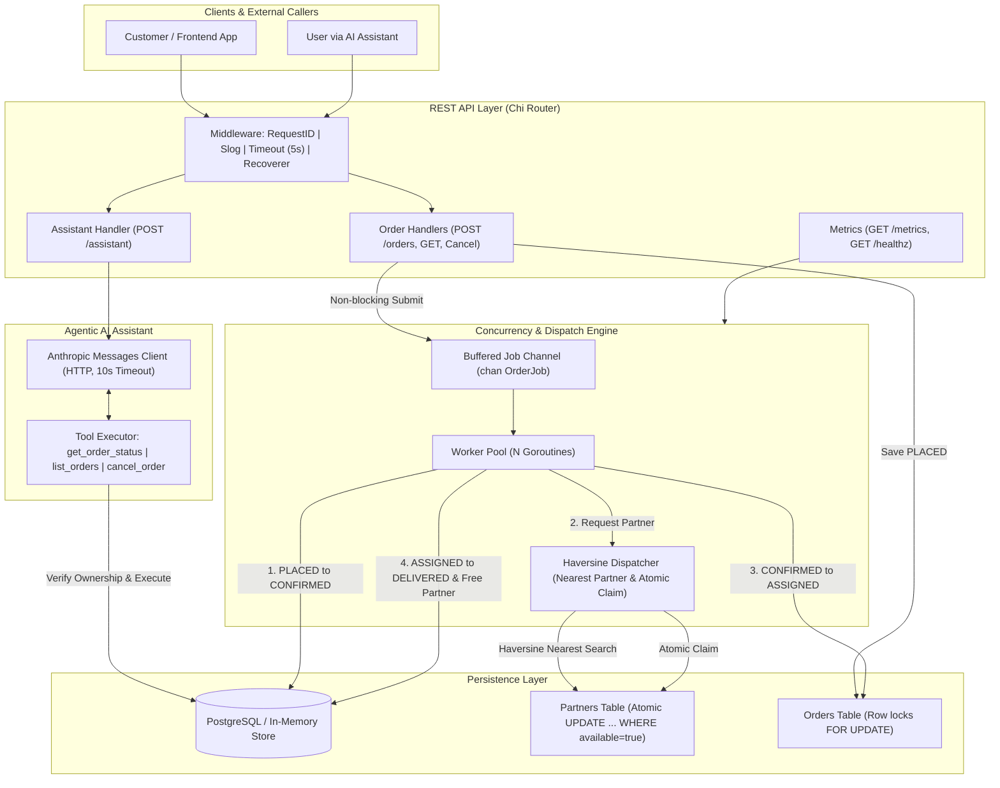

# Order Dispatch Service

A production-grade, concurrent food delivery dispatch microservice in Go. Customers place orders via a REST API, which are immediately admitted with non-blocking backpressure and processed asynchronously by a worker pool. Orders transition through confirmation, nearest available delivery partner assignment (calculated using the Haversine distance formula with atomic partner locking), and simulated transit to delivery. The service also features an agentic AI assistant powered by the Anthropic Messages API with tool-calling capabilities and strict customer authorization boundaries.

---

## Architecture Diagram



---

## How to Run

### Prerequisites
- Go 1.22+ (tested with Go 1.24)
- Docker & Docker Compose (optional; the server automatically falls back to an in-memory store if Postgres is not running)

### Running locally
```bash
# 1. Start PostgreSQL (optional)
make up

# 2. Run unit & race-detector test suites
make test

# 3. Run static analysis
make lint

# 4. Start the server (default PORT 8080)
make run
```

### Environment Variables
| Variable | Description | Default |
| :--- | :--- | :--- |
| `PORT` | HTTP server port | `8080` |
| `DATABASE_URL` | PostgreSQL connection string | `""` (falls back to thread-safe in-memory store) |
| `WORKER_COUNT` | Number of background worker goroutines | `4` |
| `LLM_API_KEY` | Anthropic API key | `""` |
| `LLM_MODEL` | Anthropic model name | `claude-3-5-sonnet-20241022` |

---

## Example `curl` Commands

### 1. Health Check
```bash
curl -s http://localhost:8080/healthz
# Response: {"status":"ok"}
```

### 2. Service Telemetry & Metrics
```bash
curl -s http://localhost:8080/metrics
# Response:
# {
#   "orders_submitted": 10,
#   "orders_delivered": 8,
#   "orders_cancelled": 1,
#   "active_workers": 1,
#   "queue_depth": 0,
#   "worker_count": 4
# }
```

### 3. Place an Order (`POST /orders`)
```bash
curl -s -X POST http://localhost:8080/orders \
  -H "Content-Type: application/json" \
  -d '{
    "customer_id": "cust_123",
    "items": [
      {"name": "Paneer Butter Masala", "qty": 1, "price_paise": 28000},
      {"name": "Butter Naan", "qty": 2, "price_paise": 4000}
    ],
    "lat": 12.9352,
    "lng": 77.6245
  }'
```

### 4. Get Order by ID (`GET /orders/{id}`)
```bash
curl -s http://localhost:8080/orders/<order_id>
```

### 5. List Orders for a Customer (`GET /orders?customer_id=...&limit=...`)
```bash
curl -s "http://localhost:8080/orders?customer_id=cust_123&limit=10"
```

### 6. Cancel an Order (`POST /orders/{id}/cancel`)
```bash
curl -s -X POST http://localhost:8080/orders/<order_id>/cancel
```

### 7. AI Assistant (`POST /assistant`)
```bash
curl -s -X POST http://localhost:8080/assistant \
  -H "Content-Type: application/json" \
  -d '{
    "customer_id": "cust_123",
    "message": "What is the status of my recent orders, and can you cancel order 5c09b807-a9b7-43a5-915b-b7c98e9f44d6 if it is not yet delivered?"
  }'
```

---

## Design Decisions

### 1. Why an In-Process Worker Pool?
- **Resource Predictability**: Unbounded goroutine creation (`go processOrder()`) per incoming HTTP request exposes the server to out-of-memory crashes and CPU starvation under traffic spikes. A fixed pool of $N$ workers bounds concurrent load.
- **Immediate Non-blocking Backpressure**: The channel buffer acts as the admission barrier. When saturated, `Submit(job)` immediately yields `ErrQueueFull` using a non-blocking `select { case ch <- job: default: }`, allowing the API to quickly respond with `503 Service Unavailable` rather than holding client connections open.

### 2. Why Atomic Partner Claiming?
- **Mutual Exclusion without Distributed Locks**: Two concurrent workers processing different orders must never assign the same delivery partner. Instead of heavy distributed locking (e.g., Redis Redlock), we use a single atomic SQL statement:
  ```sql
  UPDATE partners SET available = false WHERE id = $1 AND available = true;
  ```
  Postgres row-level locks serialize simultaneous update attempts on the same partner row. The database returns the number of rows affected:
  - If `RowsAffected == 1`, the worker successfully acquired the partner.
  - If `RowsAffected == 0`, another worker claimed the partner a millisecond earlier; our dispatcher immediately catches this and falls back to the next nearest candidate.

### 3. Graceful Shutdown Sequence
Shutdown occurs in two clean phases upon receiving `SIGINT` or `SIGTERM`:
1. **Stop Incoming Ingestion**: `http.Server.Shutdown(ctx)` is called first. It stops listening on the port and finishes existing in-flight HTTP requests, ensuring no new orders enter the queue.
2. **Drain the Job Buffer**: `Pool.Shutdown(ctx)` closes the job channel under a mutex and calls `sync.WaitGroup.Wait()` to allow workers to finish all remaining queued orders. If the grace period expires, the internal context cancels to prevent hanging indefinitely.

### 4. Crash Recovery
If the server restarts or crashes unexpectedly:
- Orders left in `PLACED` or `CONFIRMED` states were persisted to PostgreSQL before queuing.
- On startup, `RecoverUnfinishedOrders` queries for unfinished orders (`status IN ('PLACED', 'CONFIRMED')`) and re-enqueues them into the worker pool.

### 5. AI Assistant Tool Security
- **Never Trust IDs From Model**: LLMs can hallucinate UUIDs or be tricked via prompt injection into accessing another user's order.
- **Ownership Verification**: Every tool invocation (`get_order_status`, `cancel_order`) verifies that `order.CustomerID == authenticated_customer_id`. Unauthorized requests are rejected with explicit permission errors.
- **Safety Cap**: The agent loop enforces a maximum of 5 tool-calling turns to avoid infinite loops or token exhaustion.

### 6. Known Limitations & Next Steps
- **Single-Node Queue**: The buffered Go channel is in-process. In a distributed multi-replica deployment, an external broker (Apache Kafka, AWS SQS, or RabbitMQ) or a transactional outbox pattern using PostgreSQL would be used to distribute jobs across replicas.
- **Idempotency Keys**: Adding an `Idempotency-Key` HTTP header on `POST /orders` would prevent accidental double-billing if network retries occur.
- **Dead-Letter Queue (DLQ)**: Orders that fail repeatedly due to transient dispatch issues or permanent bad states should be routed to a DLQ for operational review after exponential backoff is exhausted.
- **Real-Time WebSockets**: Live order tracking updates pushed to clients via WebSockets or SSE as state transitions from `PLACED` to `DELIVERED`.
